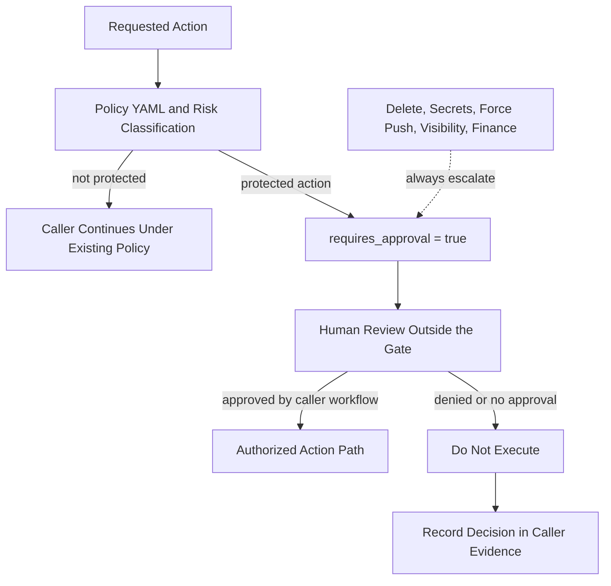
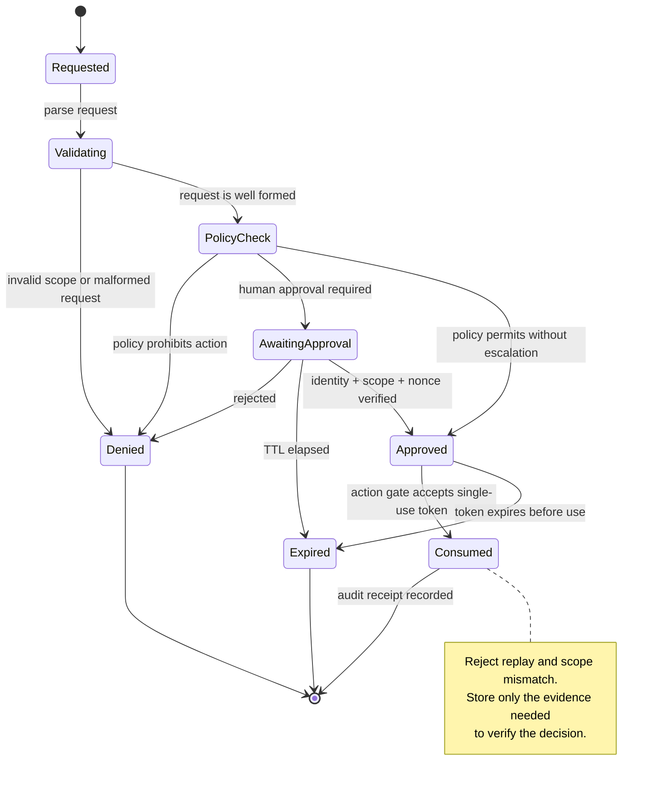

# x4-approval

**Human-in-the-loop approval gates** and risk-based autonomy controls for high-impact agent actions.

Implements **Level 3 “Never autonomous”** enforcement for the X4 / ARIEXCORE fleet.

## When approval is required

| Action | Reason |
|--------|--------|
| `delete_repository` | Irreversible data loss |
| `modify_secrets` | Credential exposure |
| `force_push_main` | History rewrite |
| `change_visibility` | Public/private flip |
| `merge_without_review` | Bypass review |
| `financial_transaction` | Money movement |
| `policy_bypass` | Circumvent gates |
| `unknown_high_impact` | Evidence state UNKNOWN |

## API (minimal)

```python
from x4_approval import requires_approval

if requires_approval("delete_repository"):
    # escalate to human — do not execute
    ...
```

<!-- X4-APEX-DIAGRAM-START:x4-approval -->



<!-- X4-APEX-DIAGRAM-END:x4-approval -->

## Policy
See `src/x4_approval/policy.yml`.

## Related
- [ariexcore-control-plane](https://github.com/dhe-cruzer69/ariexcore-control-plane)
- [x4-fleet](https://github.com/dhe-cruzer69/x4-fleet)
- [x4-beast](https://github.com/dhe-cruzer69/x4-beast)

## License
Apache-2.0

## APEX Architecture Map

> Status: architecture documentation; implementation and deployment claims require independent verification.


**Evidence note:** Identity binding, expiry, nonce consumption, and replay resistance require tests; the state machine documents intended controls, not proof they exist.

